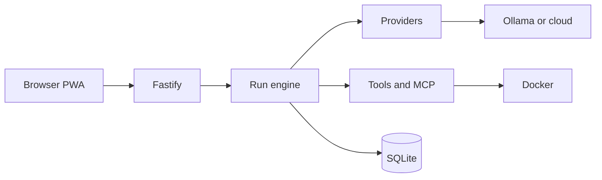

# Architecture

local-agent is one Node process and a static web app. SQLite is the system of record. The browser talks HTTP, SSE, and one WebSocket.

## Run state machine

A run is a row plus a cursor. Phases are `route`, `context`, `model`, `tools`, `summarize`, `done`.

Each boundary writes a checkpoint: the cursor, and the id of the latest message. A model call is not committed until the whole response is in. If the process dies mid-token, the step stays incomplete and resume calls the model again. A tool writes its step as `running` before it executes and `completed` after the result is stored. Resume skips completed tool calls. If a mutating tool was `running` when the process died, resume stops with an error instead of repeating the side effect. You can retry that step explicitly.

A lease and a heartbeat belong to the process. On boot, a `running` run whose lease is stale is either resumed (the default) or marked `interrupted` with a real error. `paused`, `awaiting_approval`, and `awaiting_secret` are left for you.

Config is versioned when settings change. The loop re-reads the persona and the settings between steps. A model or tool change applies on the next model call, not inside the one already streaming.

## Context

The model registry records, per known model, the theoretical context window, a practical budget, the tokenizer family, and a strategy.

| Strategy | What is sent |
| --- | --- |
| rolling | Root summary plus the newest messages that fit |
| hierarchical | Root summary, the newest open chunk summaries, then the newest messages |
| pinned | Pinned memory and only the latest turns |
| retrieval | Similar older chunks plus the newest messages |

Summaries are versioned rows. You can read them on the session. Older messages that cross the trigger are folded; hierarchical mode later folds chunk summaries into a new root.

Token counts are a calibrated estimate (Gemma 4, Qwen3, Gemini, or a generic 4 characters per token). When a Gemini key is set and the estimate is past 75% of the budget, the server calls `countTokens`. The official SentencePiece files are not bundled.

Retrieval stores float32 embeddings in SQLite. `sqlite-vec` answers nearest-neighbour queries when it loads. Otherwise the same blobs are scored with cosine similarity in process. The default embedder is a local feature hash so retrieval works offline. Gemini Embedding 2 is used when the free-tier cap is open.

## Routing

`decideRoute` is a pure function. It classifies the turn as chat, code, research, vision, long-context, or hard reasoning. It stays on the session model unless one of these is true:

- the turn is confidently hard reasoning and Gemini 4 Hydrogen has free-tier room (Argon is closed on this key)
- the current model cannot see images
- the turn does not fit the practical budget
- loading the chosen local model would put a second large model in memory, or there is not enough free RAM
- the current cloud model is out of quota and another is open
- a capable local model is already resident and the turn does not need the cloud

The default pick is a local model. Cloud is a deliberate escalation: hard reasoning, a synthesis larger than the local practical budget, a vision turn no local model can take, or two recent local failures. Gemini calls are counted against a per-model RPM and RPD. The defaults are the free-tier caps and settings can replace them. A call that would exceed the cap is not sent. The router falls back to local. You hear about a switch in one line. A quota fallback that does not change the model is only in the trace.

You hear about it only when the model actually changes. The trace always records the decision, including an unload.

## Operations

Backups are tar archives of the database, the vault ciphertext, the master key, and workspaces. An optional rsync or rclone step copies the archive off the box. Restore writes a pending flag and the process exits. The next start applies the archive before opening the database.

The watchdog restarts containers labeled as ours when they stop, and it notices when Ollama is quiet. It does not restart programs it did not create.

Telegram long-polling and web push share one notifier. Approval callbacks from Telegram call the same decision the UI does. Voice is a proxy: the browser records, faster-whisper transcribes, Kokoro speaks. If those containers are down the API says so and includes the docker command.

## Coding mode

A session with `mode = code` gains plan, grep, glob, apply_patch, git, folder grant, and CLI handoff tools.

`apply_patch` snapshots the previous bytes into `edit_batches` before it writes. The UI shows the diff and can restore that snapshot. That is the undo. Git revert is a separate, approved action because it moves HEAD.

Approval policy `sandbox-auto` lets edits inside the persona workspace proceed. A path outside the workspace needs a folder grant, and the grant is read or write. `git push` and an external CLI handoff always ask. Policy `always` asks before every edit batch too.

The external handoff looks for `cursor-agent`, `claude`, `aider`, and `codex` on `PATH`. If none is installed it says so. It does not pretend to have run them.

## MCP

Imported configs (Cursor, Claude, VS Code, `~/.config`) are stored disabled. Installing runs a vetting report: npm or PyPI metadata, download counts, GitHub stars when the repo is known, OSV vulnerabilities, and install-script inspection. The score is the sum of finding weights, capped at 100. Critical risk needs a second acknowledgement.

Stdio servers start with `docker attach` on a container built from `mcpContainerSpec`: capabilities dropped, pid limit, memory cap, tmpfs on `/tmp`, and no binds unless a grant was part of the approval. Network defaults to `bridge` only when the package has to be fetched or the server declares network. Remote HTTP MCP servers are not wrapped in a container, because we never execute their code. The report says that data can still leave the box.

This matches the Docker MCP gateway idea: the host speaks JSON-RPC over the container's stdin and stdout, and the container is the trust boundary. One server per container keeps a bad package from reading another server's files and makes the resource page able to attribute RAM.

## Vault

Secrets are AES-256-GCM ciphertext. The master key is 32 random bytes in `data/master.key`. A handle looks like `secret:GEMINI_API_KEY`. `request_secret` pauses the run in `awaiting_secret`. After you submit the value, the tool result that re-enters the model names the handle only. Shell and other tools receive the value through the environment, and the audit log records `inject`. Tool output, assistant text, and traces pass through `redact` plus an exact-value scrub of every sealed secret.

Pasted keys are encrypted into `secret_captures` and stripped from the stored message. Accepting a capture moves it into the vault.

Reveal checks the owner password and writes an audit row. Rotate re-seals. Revoke sets `revoked_at` and stops injection.

## Library, skills, and triggers

A knowledge collection is either shared or owned by one persona. Files are chunked on headings or declarations, then windowed with overlap. Embeddings come from Ollama `nomic-embed-text` when it answers, and from the local hash otherwise. Vectors live in a `sqlite-vec` table sized to the embedding, and search fuses that rank with BM25. `kb_search` returns numbered passages. A folder collection is re-indexed when the file hash changes.

A skill is `data/skills/<slug>/SKILL.md` plus optional `scripts/` and `assets/`. The catalog (name and when-to-use line) is added to the persona prompt. `load_skill` returns the body only if that persona has the skill enabled. Each save keeps a version row.

A trigger starts `startTurn`, the same checkpointed loop as chat and cron. Webhook calls check a per-trigger secret. GitHub calls check `X-Hub-Signature-256` over the raw body. A folder watch debounces. IMAP uses `EXAMINE` and `BODY.PEEK`, with the username and password read from the vault, and it has no send command.

## Auth

Cookie sessions are signed and httpOnly. Bearer tokens (`la_…`) are stored as SHA-256 hashes for a future phone or video client. Cookie-authenticated writes must come from the same host. Bearer calls may come from another origin, without credentialed CORS. Login is rate-limited. There is no default password.

## Recovery and scheduling

The scheduler wakes every 20 seconds, starts the due prompt once, and computes the next cron time. It does not catch up missed ticks one by one.

Resource samples are stored for a week. Prune previews expire after ten minutes and do nothing until confirmed.
